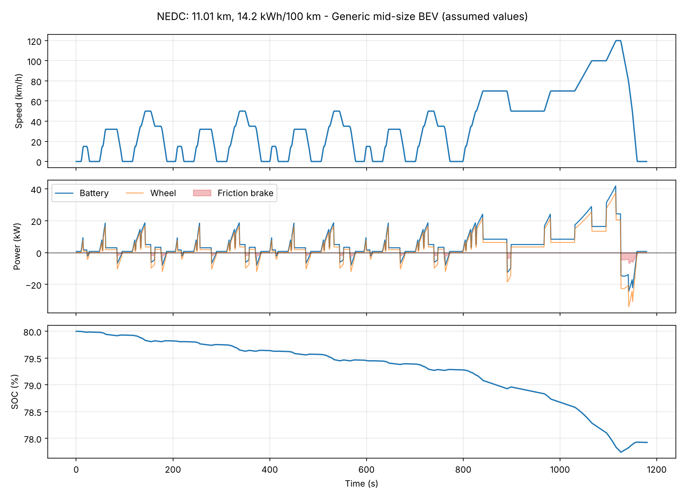
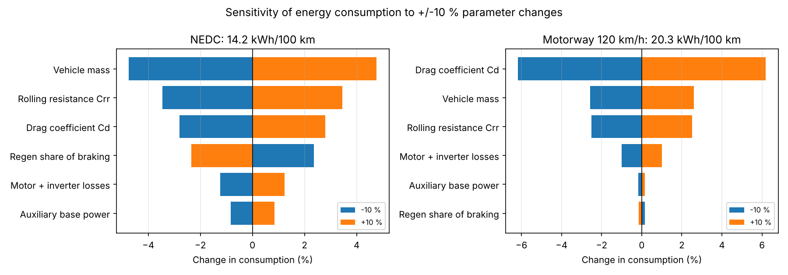
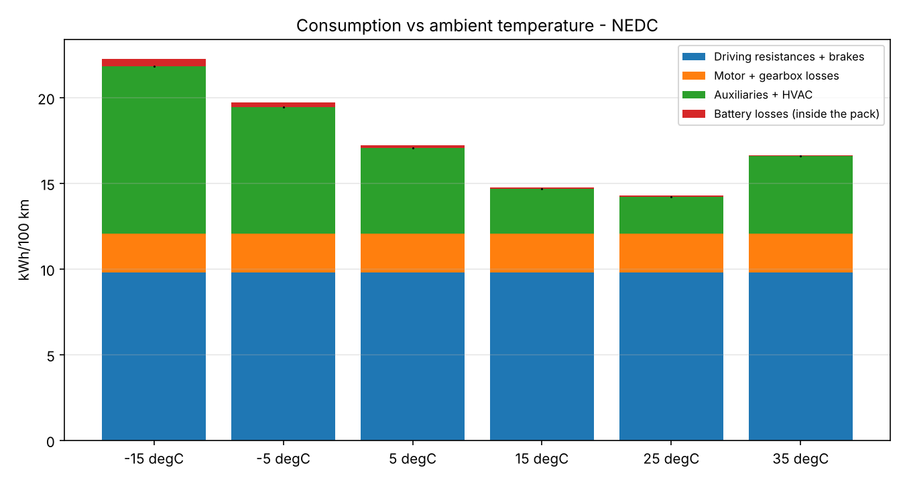
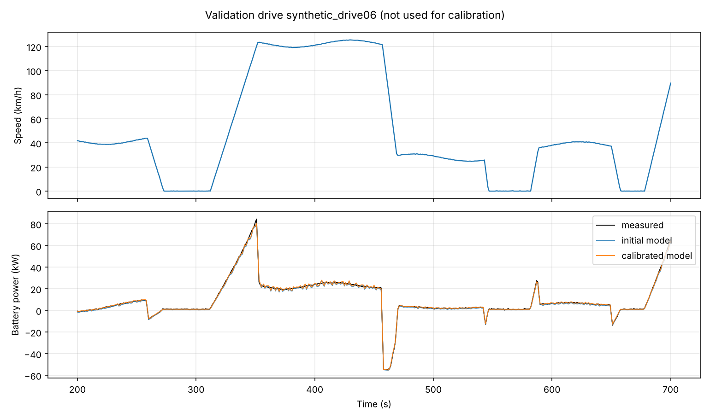
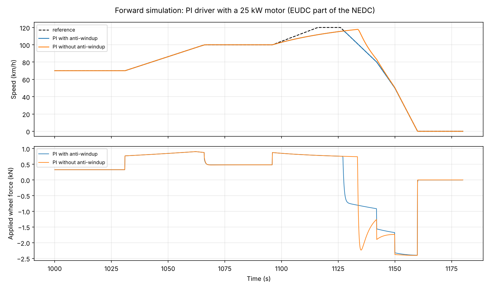

# EV-DynaSim

Electric vehicle energy simulation, calibration and validation platform.
Python for modelling, data analysis and testing; C++17 for the simulation engine.

EV-DynaSim predicts how much energy an electric vehicle draws from its battery
on a drive, and where that energy goes: aerodynamic drag, rolling resistance,
motor and gearbox losses, friction brakes, auxiliaries/HVAC and battery losses.
It calibrates uncertain vehicle parameters against measured drives and reports
how well the calibrated model predicts drives it has never seen.



## What it does

| Area | Content |
|---|---|
| Vehicle model | Longitudinal dynamics: aero drag, rolling resistance, road grade, inertia incl. rotating mass |
| Powertrain | Single-speed gearbox, motor torque envelope (constant torque / constant power), motor + inverter **loss map**, regenerative braking with power, torque and speed limits |
| Battery | Pack of cells, **1-RC equivalent circuit**, OCV(SOC) table, temperature-dependent resistance (Arrhenius), SOC-dependent charge limit, Coulomb counting |
| Thermal | Lumped battery thermal model; HVAC load as a function of ambient temperature |
| Simulation | Backward (speed in, power out) and **forward** (PI driver with feed-forward and anti-windup, RK4 / Euler) |
| Verification | Energy balance closes to 1e-10, hand calculations, integrator convergence order vs analytical solution, C++ = Python to 1e-9 |
| Calibration | Nonlinear least squares (SciPy) with confidence intervals and parameter correlation |
| Validation | Separate calibration and validation drives; RMSE, bias, trip energy error; automatic Markdown report |
| Studies | Sensitivity (tornado), ambient temperature, runtime benchmark Python vs C++ |
| C++17 engine | Same backward model, CMake, GoogleTest, C interface (`extern "C"`) as a shared library, CLI |

## Key results (generic EV with assumed parameters)

| Quantity | Value |
|---|---|
| NEDC consumption at 25 degC | 14.2 kWh/100 km |
| NEDC consumption at -15 degC | 21.8 kWh/100 km (HVAC heating dominates in city driving) |
| Largest sensitivity, city (NEDC) | vehicle mass: +/-10 % mass -> +/-4.8 % energy |
| Largest sensitivity, motorway 120 km/h | drag coefficient: +/-10 % Cd -> +/-6.2 % energy |
| Validation trip energy error, before / after calibration | 7.1 % / 0.2 % (synthetic data, see below) |
| PI driver with a too-weak motor: speed overshoot with / without anti-windup | 0.1 km/h / 17.1 km/h |
| Runtime per NEDC run: Python / C++ | 31 ms / 0.28 ms |

The vehicle parameters are assumed example values, not data of a real car.
The validation data is **synthetic** (simulated "truth" vehicle with hidden
parameters, structural differences and sensor noise), because it has a known
answer. The same pipeline runs on real measured drives through a signal-mapping
file (a template for the TUM Porsche Taycan dataset is included).

| | |
|---|---|
|  |  |
|  |  |

## Quick start (Windows)

```powershell
cd EV-DynaSim
py -3.13 -m venv .venv
.\.venv\Scripts\python.exe -m pip install -e ".[dev]"
.\.venv\Scripts\python.exe -m pytest                    # Python tests

# C++ engine (Developer PowerShell for VS 2022)
cmake -S cpp -B build
cmake --build build --config Release
ctest --test-dir build -C Release                       # C++ tests

# everything: all results, figures and reports into results\
.\.venv\Scripts\evdynasim.exe all --config configs/generic_ev.yaml --out results
```

Single commands:

```powershell
evdynasim steady   --config configs/generic_ev.yaml --speed 50 100 130
evdynasim cycle    --config configs/generic_ev.yaml --cycle nedc --out results/nedc
evdynasim cycle    --config configs/generic_ev.yaml --cycle nedc --engine cpp
evdynasim forward  --config configs/generic_ev.yaml --cycle nedc --max-power-kw 25 --out results/fwd
evdynasim study    sensitivity --config configs/generic_ev.yaml --out results/studies
evdynasim demo-validation --config configs/generic_ev.yaml --out results/validation
evdynasim validate --config configs/generic_ev.yaml --mapping my_mapping.yaml `
                   --drives d1.csv d2.csv d3.csv d4.csv --n-train 3 --out results/my_validation
build\bin\Release\evdynasim_cli.exe --config configs/generic_ev.yaml --cycle nedc
```

Full setup: [docs/01_toolchain.md](docs/01_toolchain.md).

## Repository layout

```
EV-DynaSim/
├── configs/               vehicle parameter files (YAML), loss map, data mappings
├── src/evdynasim/         Python package
│   ├── params.py          parameter structs, unit conversion, validation
│   ├── interp.py          1-D / 2-D lookup tables (same algorithm as C++)
│   ├── physics.py         road-load forces
│   ├── powertrain.py      gearbox, motor envelope, loss map, regen split
│   ├── battery.py         equivalent circuit + thermal model
│   ├── cycles.py          NEDC, CSV cycles
│   ├── simulate.py        backward simulation, energy balance
│   ├── forward.py         forward simulation, PI driver, RK4/Euler
│   ├── measured.py        import of measured drives (signal mapping, resampling)
│   ├── synthetic.py       synthetic measured drives with known truth
│   ├── calibration.py     least-squares calibration, validation metrics
│   ├── report.py          calibration/validation workflow and Markdown report
│   ├── studies.py         sensitivity, ambient temperature, benchmark
│   ├── cpp_engine.py      ctypes wrapper of the C++ shared library
│   ├── plotting.py        figures
│   └── cli.py             command line tool
├── cpp/                   C++17 engine
│   ├── include/evdynasim/ headers (incl. C interface evdynasim_c.h)
│   ├── src/               implementation
│   ├── apps/main.cpp      command line executable
│   ├── tests/             GoogleTest unit tests
│   └── CMakeLists.txt
├── tests/                 pytest suite (98 tests, incl. C++ vs Python)
├── scripts/               loss-map generator, build-and-test script
├── docs/                  design, physics, validation, C++, learning guide
└── .github/workflows/     CI configuration (Linux + Windows)
```

## Documentation

1. [Toolchain: languages, tools, libraries, setup](docs/01_toolchain.md)
2. [Architecture and design decisions](docs/02_architecture.md)
3. [Physics model](docs/03_physics_model.md)
4. [Project status and possible extensions](docs/04_roadmap.md)
5. [Learning guide and interview preparation](docs/05_learning_guide.md)
6. [Calibration and validation](docs/06_validation.md)
7. [C++ engine](docs/07_cpp_engine.md)
8. [Forward simulation and driver control](docs/08_forward_simulation.md)

## Author

Benfin Joseph - M.Sc. Electromobility (FAU Erlangen-Nürnberg), background in
model predictive control and moving horizon estimation.

## License

MIT
