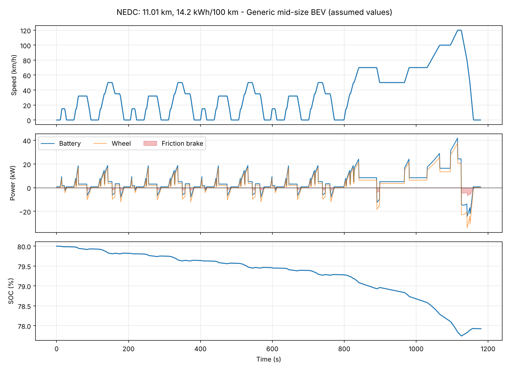
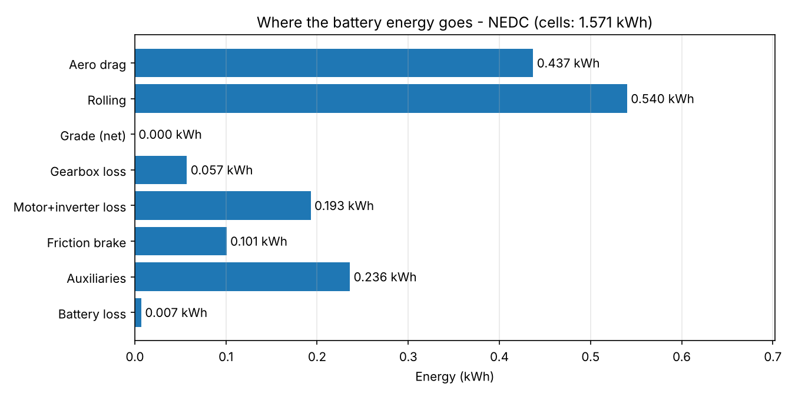
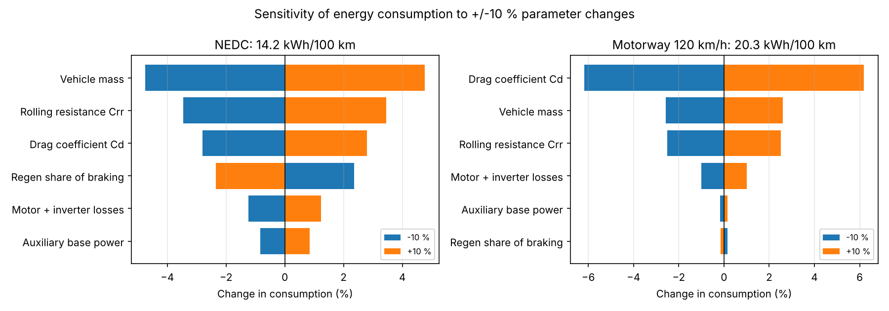
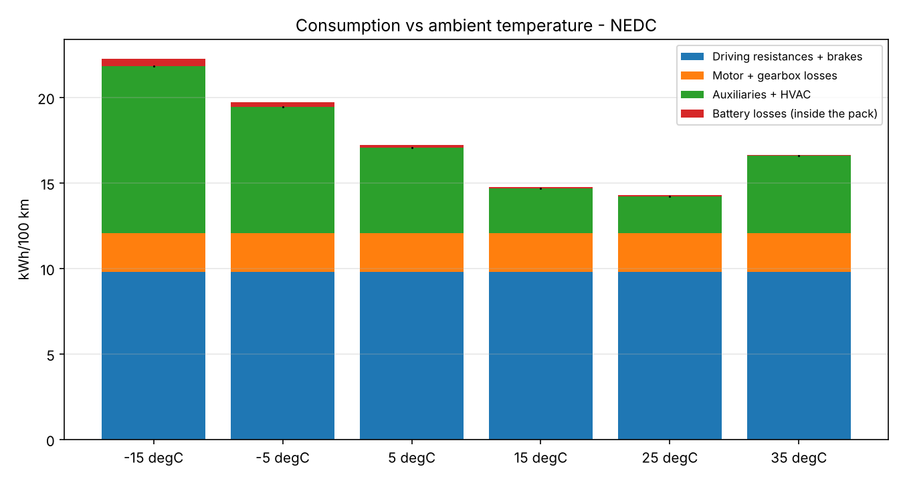
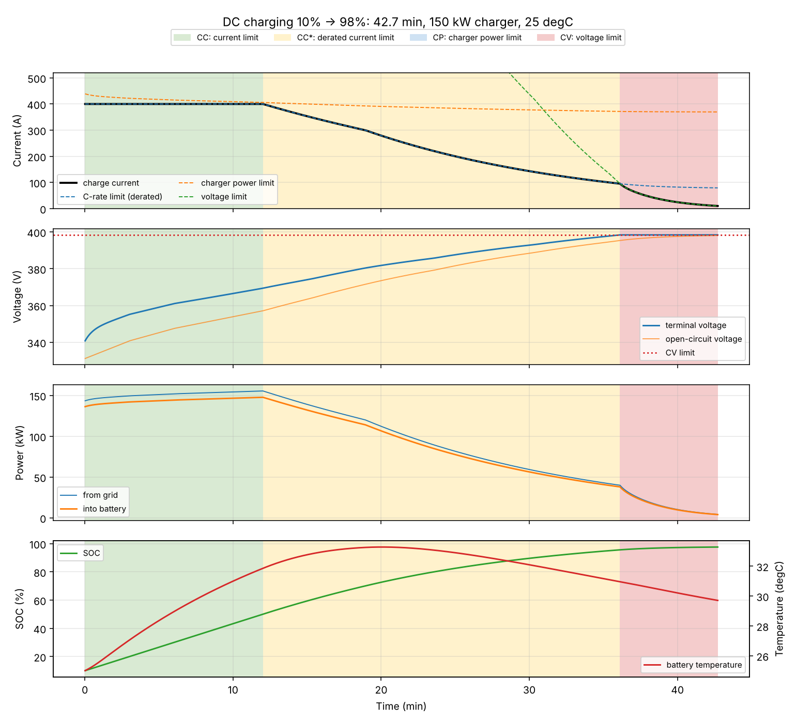
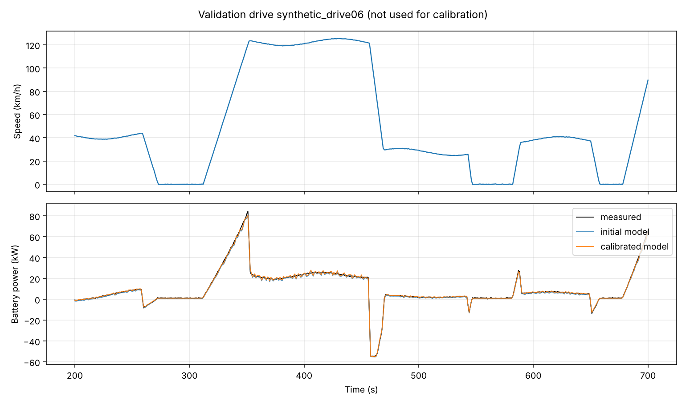
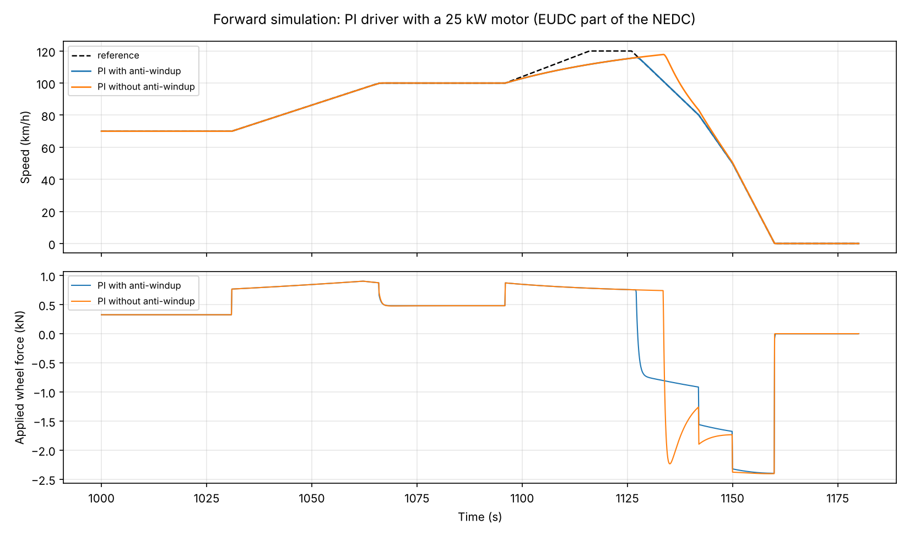

# EV-DynaSim - the project story

*How much energy does an electric car need, where does it go, how long does
it take to charge it back, and how do I know the answers are right?*

This page tells the project from problem to result. The technical details are
in the other documents in this folder.

---

## 1. The problem

Every electric vehicle program needs answers to a few questions long before a
prototype exists:

* **Range:** how much energy does the car use on a given drive?
* **Losses:** where does the energy go - air drag, tyres, motor, brakes,
  heating, battery?
* **Sizing:** how large must the battery and the motor be?
* **Charging:** how long does a fast charge take, and does the charging
  strategy keep the battery within its limits in summer and winter?

Engineers answer these with simulation models, because a model run costs
milliseconds and a test drive costs days. EV-DynaSim is such a model, built
the way it would be built in industry: physics first, verified, tested,
validated against measurements and fast enough for large studies.

## 2. The approach

| Step | Decision | Reason |
|---|---|---|
| 1 | Define the output: battery energy, its breakdown, SOC, temperature, charge time | the output decides the model |
| 2 | Quasi-static longitudinal model | the standard for energy studies: accurate to a few percent, runs in milliseconds, every parameter is physical |
| 3 | Split along the energy flow: road - wheel - gearbox - motor - battery, plus auxiliaries | each block testable and replaceable on its own |
| 4 | Backward simulation first (speed in, power out) | no ODE to solve, exact for the given drive, used for consumption tests |
| 5 | Start with a version that can be checked with a calculator | 15.34 kW at 100 km/h, verified by hand |
| 6 | Add one effect at a time, all tests green after each | regen, gearbox, motor loss map, battery circuit, thermal, HVAC, charging |
| 7 | Python as reference, C++17 as engine | Python to get the physics right, C++ for speed; both must agree to 1e-9 |
| 8 | Forward simulation with a PI driver | to check whether the car can follow the drive at all |
| 9 | Calibration and validation with separate data sets | a model is only as good as its agreement with drives it has never seen |
| 10 | Use the model for engineering studies | sensitivity, winter consumption, charging time |

## 3. What the model contains

```
Road loads ── Wheel ── Gearbox ── Motor + inverter ── Battery ── Charger
aero, rolling,          97 %      torque envelope,     1-RC circuit,   CC / CP / CV,
grade, inertia                    loss map             thermal model,  temperature and
                                                       charge limits   SOC derating
                                     Auxiliaries + HVAC ──┘
```



## 4. Results

### Where the energy goes



On the NEDC city/extra-urban cycle the generic car uses 14.2 kWh/100 km.
Rolling resistance and air drag take about 60 % of it; motor, gearbox and battery
losses together about 16 %; regenerative braking recovers 0.35 kWh of the
1.6 kWh taken from the cells.

### What matters most



In the city, vehicle **mass** has the largest effect (+/-10 % mass -> +/-4.8 %
energy). On the motorway, the **drag coefficient** dominates (+/-6.2 %).
Two cars with the same consumption label can respond very differently to a
design change, depending on where they are driven.

### Winter



At -15 degC the city consumption rises from 14.2 to 21.8 kWh/100 km. Almost
all of the increase is cabin heating: at an average speed of 33 km/h, every
kilowatt of heating adds 3 kWh/100 km.

### Charging



| Case | 10 -> 80 % on 150 kW |
|---|---|
| Battery at 25 degC | 23.6 min |
| Battery at 0 degC | 86 min |
| Battery at 0 degC, preconditioned | 23.6 min |
| 350 kW charger instead of 150 kW | 23.6 min, no gain |

In winter the **battery temperature**, not the charger, sets the charge time.
The charging strategy is checked against 13 written requirements (voltage,
current, power and temperature limits, stop conditions, energy balance) over
a matrix of ambient temperatures and charger powers - 46 test cases with
requirement IDs ([details](09_charging.md)).

## 5. How I know it is right

**Verification - is the model computed correctly?**

* The energy balance closes to 10 decimal places for every drive and every
  charging session: every joule leaving the battery is found in exactly one
  loss or resistance.
* Hand calculations are asserted in the tests.
* The C++ engine reproduces the Python reference to 1e-9 on every time step.
* The ODE integrators show the theoretical order of accuracy against an exact
  analytical solution (Euler: 1, Runge-Kutta 4: 4).
* 144 Python tests and 25 C++ tests run in one command.

**Validation - is it the right model?**

The calibration and validation pipeline was developed on synthetic measured
drives with a known truth. When the model structure matches, calibration
recovers all four true parameters within their confidence intervals. When
the "real" vehicle contains physics the model lacks, the trip energy error on
unseen drives still falls from 7.1 % to 0.2 %, but the parameters become
*effective* values - a reminder that a model that predicts well is not
automatically physically correct.



The same pipeline reads real logger data through a signal-mapping file; a
template for the TUM Porsche Taycan dataset is included.

## 6. Control



In the forward simulation a PI driver with feed-forward tracks the cycle to
0.02 km/h. With a deliberately weak 25 kW motor, the controller without
anti-windup overshoots by 17 km/h after the motor saturates; with conditional
integration the overshoot is 0.1 km/h.

## 7. Software

* Python package with a command line tool (`evdynasim cycle`, `charge`,
  `forward`, `validate`, `study`, `all`)
* C++17 engine built with CMake, tested with GoogleTest, exposed through a C
  interface and called from Python via ctypes - about 100x faster than Python
* Every figure on this page is regenerated by `evdynasim all`

## 8. Limitations and next steps

Parameters are assumptions for a generic mid-size car, and validation so far
uses synthetic data. Next: validation on real driving data (TUM Porsche
Taycan), a WLTC cycle, a preconditioning model with heater energy, and an
EKF state-of-charge estimator on the simulated battery.

---

Benfin Joseph - M.Sc. Electromobility, FAU Erlangen-Nürnberg
