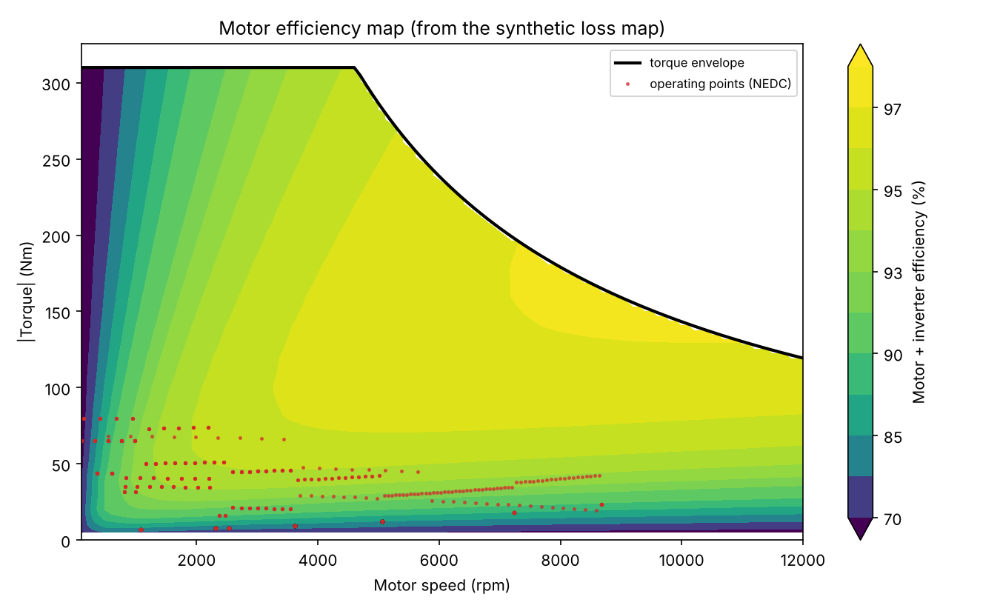
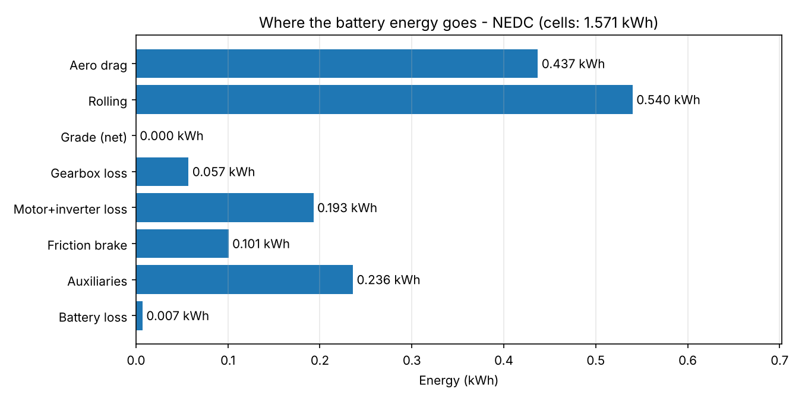
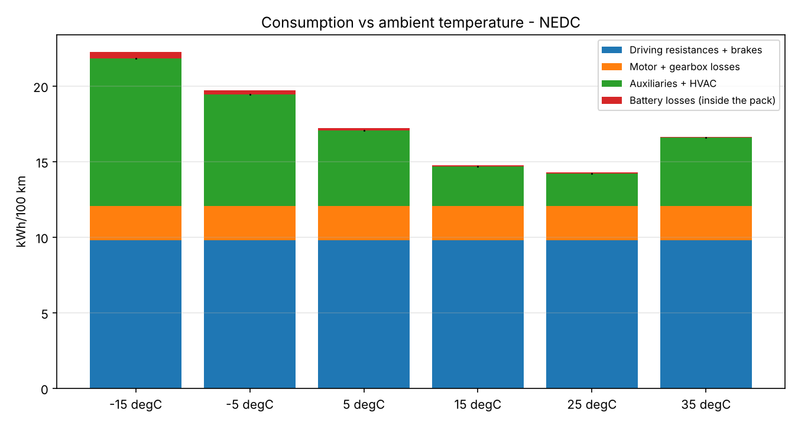

# 3. Physics model

Two configurations are provided:

* `configs/simple_ev.yaml` - constant efficiencies, no gearbox loss, ideal
  battery, no HVAC. Used for hand calculations and regression tests.
* `configs/generic_ev.yaml` - full model: loss map, gearbox, motor envelope,
  equivalent-circuit battery, thermal model, HVAC.

All parameter values are assumptions for a generic mid-size BEV, not data of
a real vehicle.

## 3.1 Road loads

Sign convention: positive force opposes forward motion.

| Force | Equation |
|---|---|
| Aerodynamic drag | F_aero = 1/2 rho Cd A v^2 |
| Rolling resistance | F_roll = m g Crr cos(theta), zero at standstill |
| Grade | F_grade = m g sin(theta), theta = atan(grade_pct / 100) |
| Inertia | F_acc = m f_rot a (f_rot = rotating mass factor, 1.03) |

F_wheel = F_acc + F_aero + F_roll + F_grade. Negative means braking.

## 3.2 Drivetrain and motor

Motor speed: w_m = v / r_wheel * i_gear (i = 9.0, r = 0.33 m).

Torque envelope (150 kW, 310 Nm, 12 000 rpm):

    T_max(w) = min(310 Nm, 150 kW / w)        base speed = 484 rad/s = 4620 rpm

**Motoring** (P_wheel > 0):

    P_mech,motor = P_wheel / eta_gearbox
    T_motor      = P_mech,motor / w_m
    P_elec       = P_mech,motor + P_loss(w_m, T_motor)

**Braking** (P_wheel < 0), P_brake = -P_wheel:

    P_regen,wheel = min(regen_fraction * P_brake, P_regen,max, T_max(w) w / eta_gb)   (0 below 5 km/h)
    P_mech,motor  = P_regen,wheel * eta_gearbox
    P_elec        = -(P_mech,motor - P_loss(w_m, T_motor))      (no regen if P_loss >= P_mech)
    P_friction    = P_brake - P_regen,wheel

**Loss map.** `configs/maps/generic_pmsm_loss.csv` is generated by
`scripts/generate_loss_map.py` from a standard PMSM loss decomposition:

    P_loss = k_cu T^2 + k_inv |T| + k_fe w^1.5 + k_fr w
             copper    inverter    iron        friction/windage

giving about 96-97 % peak efficiency and 85-90 % at high speed and low
torque. The simulator only reads the CSV, so a measured map replaces it
without code changes.

The NEDC operating points (red) sit at low torque, where efficiency is lowest.
This is why urban consumption is sensitive to motor part-load efficiency.

## 3.3 Auxiliaries and HVAC

    P_aux = P_base + k_hvac |T_ambient - T_setpoint|      (0.4 kW + 0.08 kW/K, setpoint 21 degC)

A simple, linear stand-in for heating and cooling demand.

## 3.4 Battery

Pack: 96 cells in series, 4 in parallel, 50 Ah cells -> 200 Ah, about 71 kWh.

    OCV_pack(SOC) = 96 * OCV_cell(SOC)                    (table, 3.0 ... 4.18 V)
    R0, R1 (pack) = R_cell * 96 / 4 * exp(B (1/T - 1/T_ref))     B = 3000 K
    U_term = OCV - U1 - R0 I                               (I > 0 discharge)

**Current from power.** The powertrain asks for terminal power P. With
E = OCV - U1:

    P = (E - R0 I) I   ->   I = 2P / (E + sqrt(E^2 - 4 R0 P))

If E^2 < 4 R0 P the pack cannot deliver P (above its maximum power E^2/4R0);
the step is flagged.

**Discretisation per step dt** (inputs held constant):

    U1_next  = U1 exp(-dt/tau) + R1 (1 - exp(-dt/tau)) I       exact for constant I
    SOC_next = SOC - I dt / (3600 Q)
    T_next   = T + dt (I^2 R0 + U1^2/R1 - hA (T - T_amb)) / (m c)

**Charge limit:** P_charge,max(SOC) falls linearly from 80 kW at 90 % SOC to
0 at 100 %. When regen would exceed it, regen is scaled down and the rest
goes to the friction brakes.

## 3.5 Energy balance

Per interval: P_term = P_wheel + gearbox loss + motor loss + friction + aux,
and OCV I = P_term + I^2 R0 + U1 I. Summed over a drive:

    E_chemical = E_aero + E_roll + E_grade + dE_kin + E_gearbox + E_motor
               + E_friction + E_aux + E_battery_loss

Checked to 1e-10 relative in both Python and C++ for several cycles,
including a hill cycle and a case with regen curtailment.

## 3.6 Hand calculation (simple configuration, 100 km/h, flat)

    v       = 100 / 3.6 = 27.778 m/s
    F_aero  = 0.5 * 1.225 * 0.28 * 2.3 * 27.778^2 = 304.36 N
    F_roll  = 1800 * 9.81 * 0.010               = 176.58 N
    P_wheel = (304.36 + 176.58) * 27.778         = 13 359 W
    P_batt  = 13 359 / 0.90 + 500                = 15 344 W   -> 15.34 kWh/100 km

Same values are asserted in `tests/test_physics.py` and `cpp/tests/test_physics.cpp`.

## 3.7 Results with the generic configuration

| Case | Consumption |
|---|---|
| Steady 50 / 100 / 130 km/h | 10.1 / 16.4 / 22.5 kWh/100 km |
| NEDC, 25 degC | 14.2 kWh/100 km |
| NEDC, -15 degC | 21.8 kWh/100 km |
| Motorway 120 km/h | 20.3 kWh/100 km |

In city driving at low ambient temperature the HVAC load is almost as large
as the energy needed to move the car. At 33 km/h average speed, 1 kW of
heating adds 3 kWh/100 km.

## 3.8 Known limitations

1. Losses are symmetric in torque sign (same map for motoring and regen).
2. Gearbox efficiency is constant; real gearboxes have speed- and torque-dependent losses.
3. HVAC is a linear function of ambient temperature, no cabin thermal model.
4. One RC pair; no hysteresis of OCV, no ageing.
5. Battery thermal model has passive cooling only; no active thermal management.
6. No wind, no tyre slip, no cornering losses.
7. NEDC is outdated as a consumption reference (WLTP since 2017). It is used
   because it can be generated exactly from its published definition; any
   other cycle (WLTC, measured) can be loaded from CSV.
