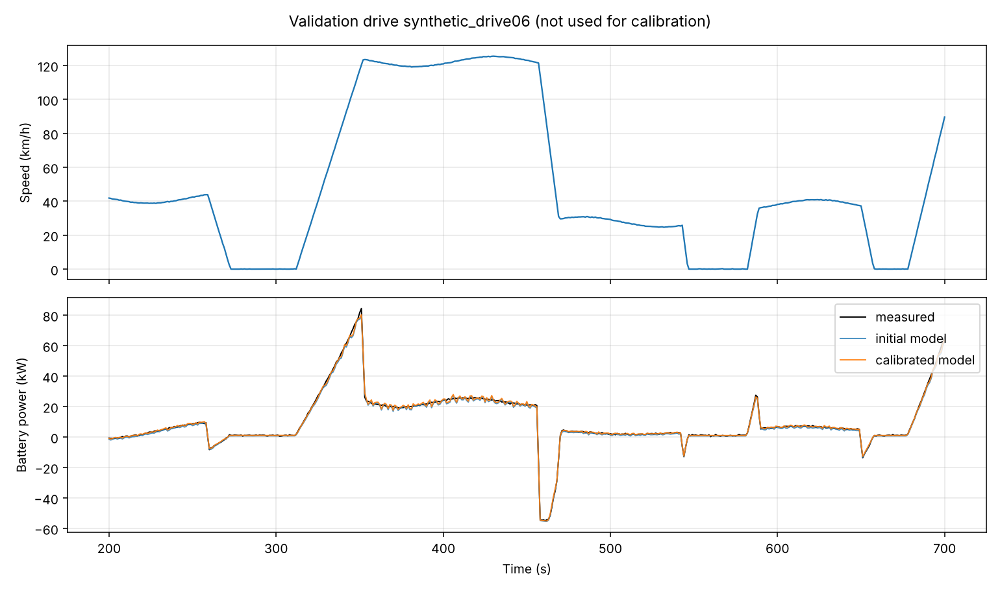
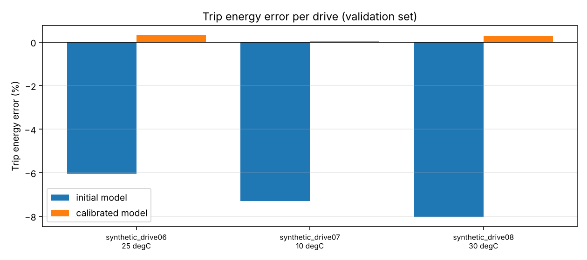

# 6. Calibration and validation

## 6.1 Workflow

```
 measured drives (CSV)  --mapping-->  MeasuredDrive objects (clean, resampled, SI)
        │
        ├── calibration drives ──► least squares ──► calibrated parameters (+ CI, correlation)
        │                                                   │
        └── validation drives ────────────────────────────► metrics, plots, report.md
```

Command for real data:

```powershell
evdynasim validate --config configs/generic_ev.yaml --mapping my_mapping.yaml `
    --drives d1.csv d2.csv d3.csv d4.csv d5.csv --n-train 3 --out results/my_validation
```

The first `n-train` files are used for calibration, the rest only for validation.

## 6.2 Importing measured data

`configs/datasets/csv_mapping_example.yaml` shows the format. For each
signal: column name, scale and offset (value_SI = raw * scale + offset).
Battery power can be given directly or as voltage and current (with
`current_sign: -1` if the logger counts discharge current as negative).

Processing in `measured.load_measured_csv`:

1. rename and scale columns
2. drop rows without time/speed/power, sort by time, drop duplicate times
3. power = voltage * current if needed
4. resample to 1 s by linear interpolation
5. clip small negative speeds to 0
6. optional moving average on speed (`--smooth`, default off)

**Why smoothing is off by default.** The backward model differentiates
speed, so noise is amplified. But smoothing also lowers acceleration peaks:
on the synthetic drives a 3-sample moving average changed predicted energy
by about -1 % without any noise. Pre-processing changes the result and must
be chosen and reported deliberately.

**Comparing model and measurement.** The model gives mean power per interval
[t_k, t_k+1]; a logger samples instantaneous power at t_k. The model value
at sample k is therefore (P_{k-1} + P_k) / 2. Comparing interval means with
samples directly produced an apparent RMSE of 2.5 kW for a perfect model;
with the correct alignment it is 0.

## 6.3 Calibration

Parameters (default): rolling resistance Crr, drag coefficient Cd, auxiliary
base power, HVAC coefficient. Objective:

    min  sum over drives and samples ( P_sim(theta) - P_meas )^2

solved with `scipy.optimize.least_squares` (trust region reflective, bounds,
parameters normalised by their initial value). Each drive is simulated with
its own ambient temperature, which is what makes the HVAC coefficient
identifiable.

Uncertainty from the Jacobian at the optimum:

    Cov = s^2 (J^T J)^-1,   s^2 = sum r^2 / (N - n_p)

This assumes independent residuals. Neighbouring samples of a time series are
correlated, so the true uncertainty is larger. The correlation matrix shows
which parameters the data cannot separate.

## 6.4 Synthetic data with a known truth

There is no real measurement data in the repository. To develop and verify
the pipeline, `synthetic.py` simulates a hidden vehicle and adds sensor noise
(300 W on power, 0.03 m/s on speed). Drives are random sequences of urban,
rural and motorway segments on a hilly road, 25 min each, ambient
temperatures from -5 to 30 degC. 5 drives are used for calibration, 3 for
validation.

**Case A - matched model structure.** The hidden vehicle differs only in the
four calibrated parameters.

| parameter | initial | estimate | 95 % CI | true |
|---|---|---|---|---|
| Crr | 0.0100 | 0.01137 | 0.01114 - 0.01160 | 0.0115 |
| Cd | 0.280 | 0.2664 | 0.2638 - 0.2690 | 0.265 |
| aux base (W) | 400 | 663 | 618 - 707 | 650 |
| HVAC (W/K) | 80 | 99.5 | 97.5 - 101.5 | 100 |

All four true values lie inside the confidence intervals. This *verifies*
the calibration code. Validation trip energy error: 6.0 % -> 0.08 %.

**Case B - structural model error.** The hidden vehicle also has more
rotating inertia (1.06 vs 1.03) and 8 % higher motor losses, which the
calibration is not allowed to change.

| parameter | estimate | 95 % CI | true |
|---|---|---|---|
| Crr | 0.01255 | 0.01242 - 0.01267 | 0.0115 |
| Cd | 0.2592 | 0.2569 - 0.2615 | 0.265 |
| aux base (W) | 605 | 565 - 644 | 650 |
| HVAC (W/K) | 97.4 | 95.2 - 99.7 | 100 |

None of the true values is inside its interval: the parameters have absorbed
the missing physics and became *effective* values. Still, the validation trip
energy error drops from 7.1 % to 0.2 %. Lesson: a well-predicting model does
not prove that its parameters are physically correct, and narrow confidence
intervals do not protect against structural error.




**Identifiability.** Crr and Cd have a correlation of about -0.95: both
are forces that oppose motion, and their effects only differ by the v^2
dependence. A test drive with long constant-speed sections at very different
speeds (or a coast-down test) separates them best.

## 6.5 Metrics

| Metric | Meaning |
|---|---|
| RMSE (kW) | typical size of the instantaneous power error |
| bias (kW) | mean error, systematic over- or under-prediction |
| max abs error (kW) | worst instant (often time-alignment problems) |
| trip energy error (%) | the number that matters for range prediction |
| consumption measured / simulated | kWh/100 km for both |

The remaining RMSE of about 0.8 kW after calibration comes mostly from the
speed noise: 0.03 m/s noise on speed gives about 0.04 m/s^2 noise on
acceleration, which is about 80 N, or 2 kW at 25 m/s. The trip energy is not
affected because the noise averages out.

## 6.6 Using real data (TUM Porsche Taycan)

1. Download a few measurement files, read the licence.
2. Look at one file (pandas `read_csv(...).columns`) and fill in the
   placeholders in `configs/datasets/tum_taycan_template.yaml`.
3. Create `configs/taycan.yaml` from published data (paper DOI
   10.3390/wevj16060296): mass, frontal area, wheel radius, gear ratio of the
   gear used most, battery size. Use the constant-efficiency motor model if
   no loss map is available, and calibrate the efficiency as an extra
   parameter (`CalibParam("motor.constant_efficiency", 0.8, 0.98)`).
4. Run `evdynasim validate` with 60-70 % of the drives for calibration.
5. Report honestly what does not fit (for example the second gear).
