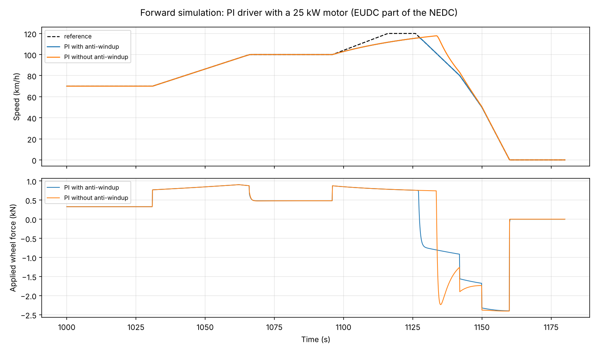

# 8. Forward simulation and driver control

## 8.1 Model

State x = [v, s] (speed, distance):

    m_eff dv/dt = F - F_aero(v) - F_roll(v) - F_grade(s)
    ds/dt       = v

Grade is looked up by **distance** along the route, not by time: a slower
vehicle reaches the hill later. At standstill the car is held by the brakes
(no rolling backwards, no creeping).

Applied force limits:

    F_max(v) = T_max(w_m) * i_gear * eta_gb / r_wheel     (0 above max motor speed)
    F_min    = -9 m/s^2 * m                                (friction + regen)

## 8.2 Driver: PI with feed-forward

    F_ff  = m_eff a_ref + F_res(v_ref)          inverse vehicle model
    F_cmd = F_ff + Kp (v_ref - v) + Ki integral(v_ref - v)
    Kp = m_eff * 2 rad/s,  Ki = Kp / 5 s,  sample time 0.1 s (zero-order hold)

The feed-forward term does most of the work; the PI part only corrects model
errors and disturbances. With the generic vehicle on the NEDC the speed
error RMSE is 0.02 km/h.

## 8.3 Anti-windup

When the demanded force exceeds what the motor can deliver, the integral of
the error keeps growing ("windup"). Once the vehicle catches up, the large
integral pushes it past the reference.

Conditional integration: freeze the integrator while the output is
saturated *and* the error would drive it further into saturation.

Test case: motor limited to 25 kW, NEDC. In the 100 -> 120 km/h acceleration
of the EUDC the car cannot follow.

| | max overshoot after the saturation |
|---|---|
| PI without anti-windup | 17.1 km/h |
| PI with conditional integration | 0.1 km/h |



## 8.4 Integrators and verification

Explicit Euler and classical Runge-Kutta 4. Verification against the exact
coast-down solution on a flat road:

    m dv/dt = -(A + B v^2),  A = m g Crr, B = 1/2 rho Cd A_f
    v(t) = sqrt(A/B) tan( atan(v0 sqrt(B/A)) - sqrt(A B) t / m )

Error at t = 60 s from v0 = 30 m/s for step sizes 2, 1, 0.5 s:

| Method | error ratio when h is halved | observed order |
|---|---|---|
| Euler | 2.0 | 1 |
| RK4 | 16.5 | 4 |

The test `test_integrator_order_on_analytical_coastdown` asserts the order
within +/-0.15.

## 8.5 Energy

The achieved trajectory (time, speed, grade along the driven distance) goes
through the backward energy model. On the NEDC the forward result differs
from the backward result by 0.13 %, caused by the small tracking error and
the finer time step (0.1 s vs 1 s). The test requires < 1 %.

## 8.6 Command line

```powershell
evdynasim forward --config configs/generic_ev.yaml --cycle nedc --out results/forward
evdynasim forward --config configs/generic_ev.yaml --cycle nedc --max-power-kw 25 --no-anti-windup
evdynasim forward --config configs/generic_ev.yaml --cycle nedc --integrator euler
```
