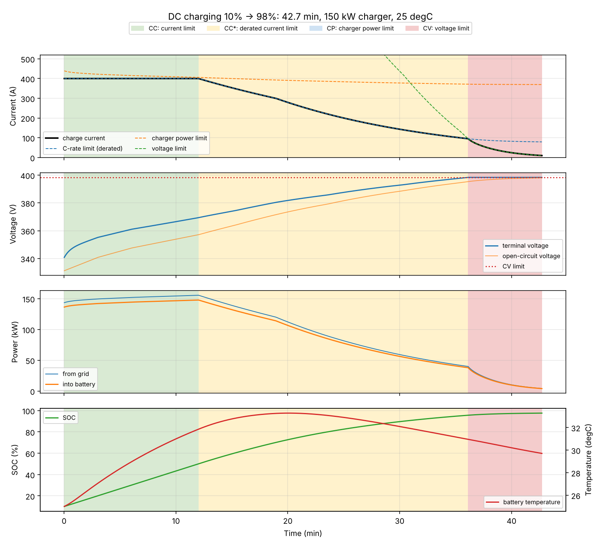
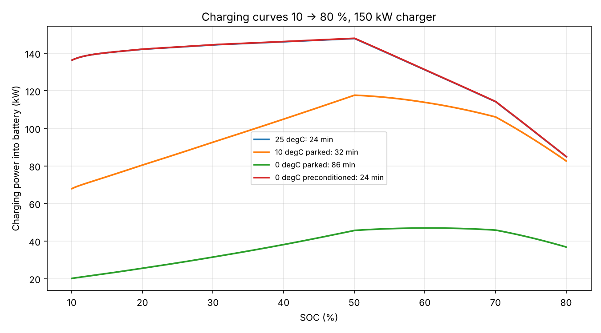
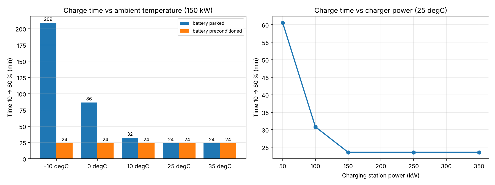

# 9. DC fast charging and its test specification

## 9.1 The problem

A driver at a 150 kW charger asks: **how long until 80 %?** The engineers
behind the charging system ask a harder question: **does the charging
strategy always respect the battery's limits** (voltage, current,
temperature), for every combination of outside temperature, battery state and
charger power?

This part of EV-DynaSim answers both. It simulates a charging session and
checks it against a written list of requirements, in the same way charging
software is tested on a test bench.

## 9.2 How a BMS controls charging

At every time step the battery management system (BMS) allows the smallest of
three currents:

| Limit | Formula | Why it exists |
|---|---|---|
| C-rate limit | I = f(T) * g(SOC) * 2C * Q | cell manufacturer's current limit, reduced when the battery is cold or hot (f) and when it is nearly full (g) |
| Charger power limit | I from P = U_term * I = 150 kW | the charging station cannot deliver more |
| Voltage limit | I = (U_max - (OCV - U1)) / R0 | cell voltage must not exceed 4.15 V, or the cell ages fast or becomes unsafe |

Whichever limit is the smallest names the **phase**:

| Phase | Active limit | What you see |
|---|---|---|
| CC | C-rate | constant current, power rises slowly with voltage |
| CC* | derated C-rate | current reduced by temperature or SOC |
| CP | charger power | constant power, current falls as voltage rises |
| CV | voltage | voltage held at the limit, current tapers off |

Charging stops at the target SOC, when the CV current falls below C/20, or
when the battery reaches 55 degC.

The battery is the same model as for driving (equivalent circuit + thermal
model) plus **active cooling** during charging:
Q_cooling = 250 W/K * max(T - 25 degC, 0).

The derating tables are in `configs/generic_ev.yaml`, section `charging`.



A full charge 10 % -> 98 % at 25 degC: 12 min CC at 400 A, then SOC derating
(CC*) from 50 % SOC, then the voltage limit takes over at about 96 % and the
current tapers until C/20.

## 9.3 Results (generic vehicle, 150 kW charger)

| Case | Time 10 -> 80 % |
|---|---|
| 25 degC | 23.6 min |
| 10 degC, battery parked at ambient | 32 min |
| 0 degC, parked | 86 min |
| -10 degC, parked | 209 min |
| 0 degC or -10 degC, battery preconditioned to 25 degC | 23.6 min |
| 50 kW charger | 60.6 min |
| 100 kW charger | 30.8 min |
| 250 or 350 kW charger | 23.6 min (no gain: the battery is the limit) |

Energy for 10 -> 80 % at 25 degC: 54.1 kWh from the grid, 2.7 kWh charger
losses, 1.6 kWh battery losses, 49.8 kWh stored. Grid-to-cell efficiency 92 %.




**Engineering conclusions**

1. In winter the battery temperature, not the charger, decides the charge
   time. A cold battery charges at a fraction of the current and barely heats
   itself. This is why real vehicles **precondition** the battery when the
   driver navigates to a fast charger.
2. A 350 kW charger is not faster than a 150 kW one for this vehicle. The
   battery's current limit is reached first.
3. Above 50 % SOC the BMS taper dominates. That is why "10 to 80 %" is the
   industry figure: the last 20 % takes almost as long as the first 70 %.

## 9.4 Test specification

Every test in `tests/test_charging.py` carries the ID of the requirement it
verifies. The safety requirements are tested over a **scenario matrix**:
ambient -10 / 25 / 40 degC x charger 50 / 350 kW, each a full charge
10 -> 100 %.

| ID | Requirement | Type | Test |
|---|---|---|---|
| REQ-CHG-01 | Terminal voltage never exceeds the CV limit (96 x 4.15 V) | safety | scenario matrix |
| REQ-CHG-02 | Charge current never exceeds 2C, nor the derated limit of that step | safety | scenario matrix |
| REQ-CHG-03 | Power into the battery never exceeds the charger rating | safety | scenario matrix |
| REQ-CHG-04 | No current flows at or above 55 degC; hot battery is derated; charging stops when too hot | safety | worst case: 40 degC ambient, 48 degC battery, no cooling, 350 kW |
| REQ-CHG-05 | Charging stops in the first step that reaches the target SOC | function | 10 -> 80 % |
| REQ-CHG-06 | SOC rises monotonically and never exceeds 100 % | function | scenario matrix |
| REQ-CHG-07 | Energy balance: grid = charger loss + battery loss + stored, to 1e-10 | model integrity | scenario matrix |
| REQ-CHG-08 | Current never rises during the CV phase | function | scenario matrix |
| REQ-CHG-09 | Cold battery charges more than 2x slower; preconditioning restores the warm charge time | performance | 0 vs 25 degC |
| REQ-CHG-10 | More charger power never makes charging slower; above the battery limit it gives no gain | performance | 50 ... 350 kW |
| REQ-CHG-11 | Invalid requests (start SOC >= target, missing charging data) are rejected | robustness | |
| REQ-CHG-12 | A full charge ends with a CV taper at C/20 | function | 10 -> 100 % |
| REQ-CHG-13 | Design target: 10 -> 80 % in under 30 min at 25 degC on 150 kW | performance | |

46 test cases in total (the matrix multiplies the safety tests by 6
scenarios). Run them alone with:

```powershell
.\.venv\Scripts\python.exe -m pytest tests/test_charging.py -v
```

**Why this structure.** In automotive testing a test without a requirement
has no purpose, and a requirement without a test is not verified. The table
gives **traceability** in both directions. Safety requirements are tested
over many conditions, because a limit that holds at 25 degC can still be
violated at -10 degC or 40 degC. The worst-case test for REQ-CHG-04
deliberately removes the cooling: a safety function has to work when other
parts of the system fail.

## 9.5 Commands

```powershell
evdynasim charge --config configs/generic_ev.yaml --soc-start 0.1 --soc-target 0.8 --out results/charge
evdynasim charge --config configs/generic_ev.yaml --ambient -10 --battery-temp 25 --out results/charge_precond
evdynasim charge --config configs/generic_ev.yaml --charger-kw 50
evdynasim study charging --config configs/generic_ev.yaml --out results/charging
```

## 9.6 Limitations

* The derating tables are assumed, not taken from a real cell data sheet.
* No preconditioning *process*: the battery simply starts warm. Modelling the
  heater energy and time before arrival would be the next step.
* One lumped battery temperature; real packs have cell-to-cell differences
  and the hottest cell decides the derating.
* No charger-vehicle communication (ISO 15118 / DIN 70121), no AC charging.
* The charger is assumed to follow the requested current instantly.
